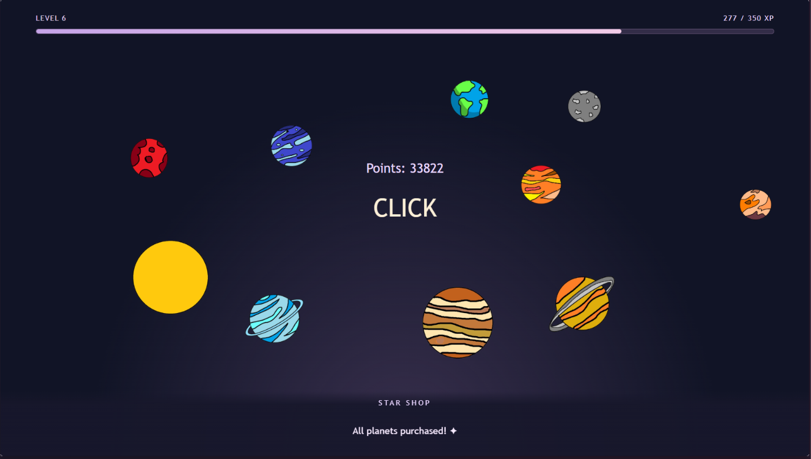
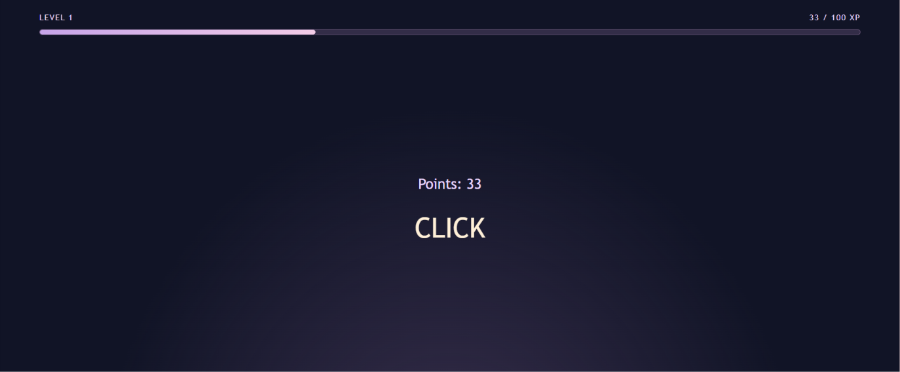
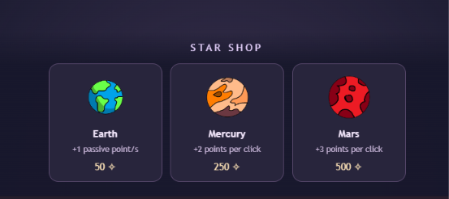
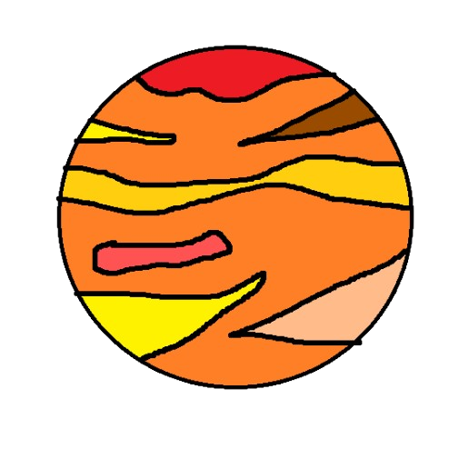
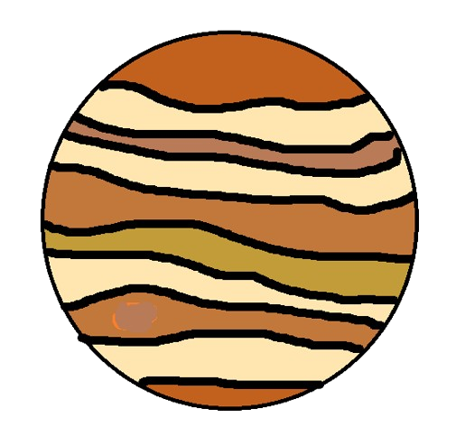
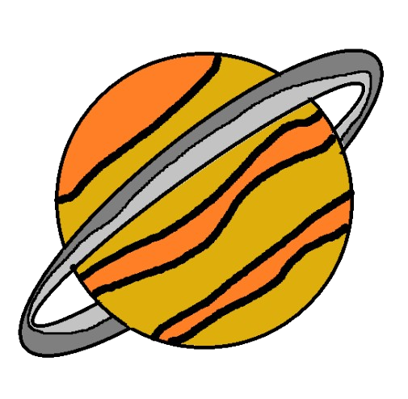
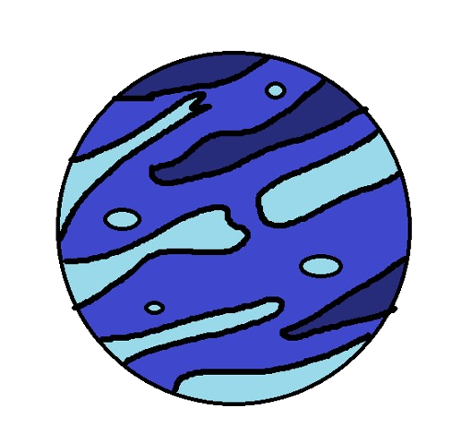
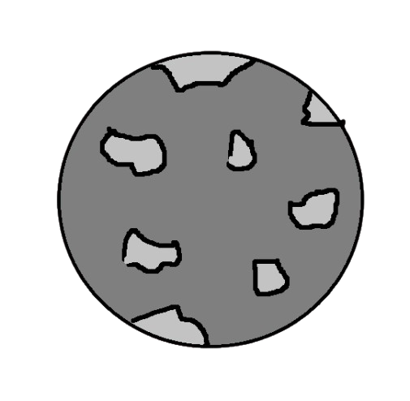
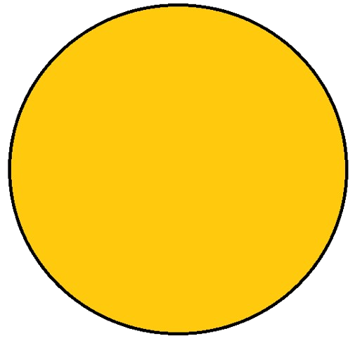

# Touch the Star
*A game where you touch the stars… not literally.*

A clicker game where you earn points by clicking the screen. You can exchange those points for celestial bodies!

> [!NOTE]
> Try my [game here](https://hallow303.github.io/Touch-the-star/).

## Features
The game has the following mechanics:

### 1. Clicking
Click anywhere on the screen to earn points. Little stars appear whenever you click! :D

### 2. Experience and Levels
Whenever you earn points, you also gain XP. At first, the amount of XP you earn is equal to the number of points, but this can change when you purchase celestial bodies.
You can keep track of your level using the experience bar at the top of the screen.

### 3. Shop
You can exchange the points you've earned for celestial bodies in the shop. Each one provides a different upgrade.
The shop always displays 3 celestial bodies available for purchase, sorted from cheapest to most expensive.
There are 10 celestial bodies available!

### Available Celestial Bodies

| Image | Celestial Body | Bonus |
|:---:|---|---|
|  | Earth | +1 passive point/s |
|  | Mercury | +2 points per click |
|  | Mars | +3 points per click |
|  | Venus | +25% click production |
|  | Jupiter | Doubles passive production |
|  | Saturn | +25% XP |
|  | Uranus | +50% passive production |
|  | Neptune | +20 points every 10 clicks |
|  | Moon | +50% XP |
|  | Sun | +15% all production and XP |
